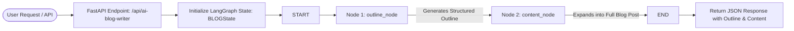

# ✍️ AI Blog Writer

[](https://fastapi.tiangolo.com)
[](https://langchain-ai.github.io/langgraph/)
[](https://www.langchain.com/)
[](https://groq.com/)
[](https://www.python.org/)
[](#license)

An asynchronous, agentic AI content generation engine designed to research, structure, and draft production-grade blog posts from a single title. Built with **FastAPI**, **LangGraph**, and accelerated by **Groq Cloud** LLM inference.

---

## 📌 Table of Contents

- [Overview](#-overview)
- [Key Features](#-key-features)
- [System Architecture](#-system-architecture)
- [Project Structure](#-project-structure)
- [Tech Stack](#-tech-stack)
- [Prerequisites](#-prerequisites)
- [Installation & Setup](#-installation--setup)
- [Running the Application](#-running-the-application)
- [API Reference](#-api-reference)
  - [Health Check](#health-check)
  - [Generate Blog Post](#generate-blog-post)
- [LangGraph Workflow Execution](#-langgraph-workflow-execution)
- [Configuration & Customization](#-configuration--customization)
- [Contributing](#-contributing)
- [License](#-license)

---

## 🌟 Overview

Writing high-ranking, engaging blog posts requires a structured approach: analyzing search intent, crafting a comprehensive outline, and writing comprehensive, human-like content.

**AI Blog Writer** decouples this process into a deterministic two-stage pipeline orchestrated via **LangGraph**:
1. **Outline Strategist (`outline_node`)**: Analyzes the title, outlines target search intent, audience personas, and hierarchical headers (`H2`, `H3`).
2. **Content Craftsman (`content_node`)**: Takes the title and structured outline to produce an in-depth, publication-ready article free of robotic fillers or hallucinations.

By leveraging **Groq LPU™** technology, the end-to-end generation is delivered in seconds.

---

## ⚡ Key Features

- **Multi-Node Agentic Pipeline**: Powered by LangGraph's state machine, separating outline generation from full-article expansion for superior quality.
- **Ultra-Fast LLM Inference**: Integrated with Groq (`ChatGroq`) for rapid content delivery.
- **Type-Safe & Validated**: Built with Pydantic schemas and typed state definitions (`TypedDict`).
- **RESTful API Architecture**: Modular FastAPI structure with automated OpenAPI / Swagger documentation.
- **SEO & Readability-Driven Prompts**: Prompts engineered to avoid keyword stuffing, adhere to logical progression, and prioritize reader value.

---

## 🏗️ System Architecture



### State Machine Flow

| Phase | Component | Model / Engine | Output State Key |
| :--- | :--- | :--- | :--- |
| **Input** | `BlogRequest` | Pydantic | `title` |
| **Stage 1** | `outline_node` | `ChatGroq` (`openai/gpt-oss-120b`) | `outline` |
| **Stage 2** | `content_node` | `ChatGroq` (`openai/gpt-oss-20b`) | `content` |
| **Final State** | `workflow.invoke()` | LangGraph Compiler | `{ title, outline, content }` |

---

## 📂 Project Structure

```text
AI_Blog_writer/
├── api/
│   └── route.py             # FastAPI router & endpoint definitions
├── core/
│   └── llm_config.py        # Groq client initializations and parameters
├── graph/
│   ├── graph.py             # LangGraph StateGraph assembly and workflow compilation
│   └── node.py              # Node execution logic (outline & content generators)
├── prompt/
│   ├── outline_prompt.py    # Outline strategy system prompt
│   └── content_prompt.py    # Article expansion system prompt
├── schema/
│   ├── input.py             # Pydantic request models
│   └── state.py             # LangGraph BLOGState TypedDict schema
├── Jupyter/
│   └── AI_blog_generator.ipynb  # Interactive development & experimentation notebook
├── .env                     # Environment variables (API keys)
├── .gitignore               # Git ignore patterns
├── main.py                  # Application entry point & FastAPI setup
├── requirements.txt         # Project dependencies
└── Readme.md                # Project documentation
```

---

## 💻 Tech Stack

- **Web Framework:** [FastAPI](https://fastapi.tiangolo.com/) - High-performance Python web framework.
- **Workflow Orchestration:** [LangGraph](https://langchain-ai.github.io/langgraph/) - Stateful, multi-agent graph management.
- **LLM Integration:** [LangChain](https://www.langchain.com/) & [LangChain-Groq](https://github.com/langchain-ai/langchain-groq) - LLM interface and Groq client wrapper.
- **Validation:** [Pydantic v2](https://docs.pydantic.dev/) - Request validation and settings management.
- **Server:** [Uvicorn](https://www.uvicorn.org/) - Lightning-fast ASGI web server.

---

## ⚙️ Prerequisites

- **Python 3.10+**
- A **Groq Cloud API Key** (Create one for free at [console.groq.com](https://console.groq.com/keys))

---

## 🚀 Installation & Setup

### 1. Clone the Repository

```bash
git clone https://github.com/hasnainyaqub/AI_Blog_writer.git
cd AI_Blog_writer
```

### 2. Create and Activate a Virtual Environment

**Linux / macOS:**
```bash
python3 -m venv venv
source venv/bin/activate
```

**Windows (PowerShell):**
```powershell
python -m venv venv
.\venv\Scripts\Activate.ps1
```

### 3. Install Dependencies

```bash
pip install --upgrade pip
pip install -r requirements.txt
```

### 4. Configure Environment Variables

Create a `.env` file in the project root directory:

```env
GROQ_API_KEY=gsk_your_groq_api_key_here
```

---

## 🖥️ Running the Application

Start the local development server with auto-reload:

```bash
uvicorn main:app --reload --host 127.0.0.1 --port 8000
```

Once running, access the services:
- **API Base URL:** `http://127.0.0.1:8000`
- **Interactive Swagger UI:** `http://127.0.0.1:8000/docs`
- **ReDoc Documentation:** `http://127.0.0.1:8000/redoc`

---

## 📖 API Reference

### Health Check

Verify that the server is healthy.

- **URL:** `/health`
- **Method:** `GET`
- **Response:**
  ```json
  {
    "health": 200
  }
  ```

---

### Root Status

- **URL:** `/`
- **Method:** `GET`
- **Response:**
  ```json
  {
    "message": "AI_Blog_Generator"
  }
  ```

---

### Generate Blog Post

Generates a structured outline and a full-length blog post based on the provided title.

- **URL:** `/api/ai-blog-writer`
- **Method:** `POST`
- **Headers:** `Content-Type: application/json`

#### Request Body
```json
{
  "title": "The Future of Artificial Intelligence in Healthcare"
}
```

#### Example cURL Request
```bash
curl -X POST "http://127.0.0.1:8000/api/ai-blog-writer" \
     -H "Content-Type: application/json" \
     -d '{"title": "The Future of Artificial Intelligence in Healthcare"}'
```

#### Example Python Request
```python
import requests

url = "http://127.0.0.1:8000/api/ai-blog-writer"
payload = {"title": "The Future of Artificial Intelligence in Healthcare"}

response = requests.post(url, json=payload)
data = response.json()

print(f"Title: {data['title']}")
print("\n--- Outline ---\n")
print(data['results']['outline'])
print("\n--- Content ---\n")
print(data['results']['content'])
```

#### Response Structure (`200 OK`)
```json
{
  "title": "The Future of Artificial Intelligence in Healthcare",
  "results": {
    "title": "The Future of Artificial Intelligence in Healthcare",
    "outline": "# The Future of Artificial Intelligence in Healthcare\n\n## Introduction\n- Overview of AI in modern medicine...",
    "content": "Artificial intelligence is rapidly shifting from an experimental novelty into an indispensable cornerstone of healthcare..."
  }
}
```

#### Error Response (`500 Internal Server Error`)
```json
{
  "detail": "Error description or Groq API connection issue"
}
```

---

## 🔄 LangGraph Workflow Execution

The execution pipeline operates on a centralized state dictionary defined in `schema/state.py`:

```python
class BLOGState(TypedDict):
    title: str
    outline: str
    content: str
```

1. **State Initialization:** The user provides `title`.
2. **`outline_node`:**
   - Injects the title into the strategic outline prompt.
   - Calls Groq LLM to formulate sections, subsections, target intent, and logical flow.
   - Stores the generated structure into `state['outline']`.
3. **`content_node`:**
   - Consumes both `state['title']` and `state['outline']`.
   - Injects them into the deep-content synthesis prompt.
   - Emits conversational, high-retention markdown content into `state['content']`.
4. **Graph Exit (`END`):**
   - Returns the complete state object back to the API controller.

---

## 🛠️ Configuration & Customization

### Modifying LLM Models & Temperatures

You can modify models or adjust creativity levels in `core/llm_config.py`:

```python
# Outline Generator
llm = ChatGroq(
    model="openai/gpt-oss-120b",
    temperature=0.5
)

# Content Generator
llm_content = ChatGroq(
    model="openai/gpt-oss-20b",
    temperature=0.5
)
```

> **Note:** Supported Groq models include `llama-3.3-70b-versatile`, `mixtral-8x7b-32768`, `gemma2-9b-it`, and any custom model IDs available in your Groq workspace.

### Refining Writing Guidelines & Rules

To alter writing styles, tone, length, or SEO guidelines:
- Edit `prompt/outline_prompt.py` for structural and outline behavior.
- Edit `prompt/content_prompt.py` for tone, voice, paragraph formatting, and length constraints.

---

## 🤝 Contributing

Contributions are welcome! To contribute:

1. **Fork** the repository.
2. **Create a feature branch:**
   ```bash
   git checkout -b feature/awesome-feature
   ```
3. **Commit your changes:**
   ```bash
   git commit -m "Add awesome new feature"
   ```
4. **Push to the branch:**
   ```bash
   git push origin feature/awesome-feature
   ```
5. **Open a Pull Request**.

---

## 📄 License

This project is licensed under the **MIT License**. See the [LICENSE](LICENSE) file for details.
